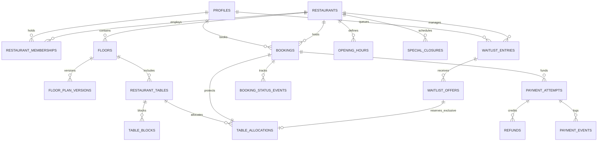

# Conceptual Entity-Relationship Model & Relational Integrity

## Purpose
This document specifies the conceptual entity-relationship diagram (ERD), table ownership boundaries, and core relational integrity invariants for the Dine backend modular monolith.

Fulfills the conceptual ERD requirement of **EPIC-001** and aligns with Blueprint §4, §5.1, §5.2, §5.3, and §5.4.

---

## 1. Domain Ownership Map

```text
+-----------------------+     +-----------------------+
|  Identity & Access    |     |  Restaurant Profile   |
|  - profiles           |     |  - restaurants        |
|  - memberships        |     |  - opening_hours      |
+-----------------------+     |  - special_closures   |
                              +-----------------------+
                                          |
                                          v
+-----------------------+     +-----------------------+
|  Floor & Inventory    |     |  Availability         |
|  - floors             |<--->|  - table_blocks       |
|  - floor_plan_versions|     |  - candidate intervals|
|  - restaurant_tables  |     +-----------------------+
+-----------------------+                 |
           |                              |
           v                              v
+-----------------------------------------------------+
|  Booking & Allocation Core                          |
|  - bookings                                         |
|  - table_allocations  [GiST Exclusion Constraint]   |
|  - booking_status_events                            |
+-----------------------------------------------------+
           |                              |
           v                              v
+-----------------------+     +-----------------------+
|  Payment Inbox & Rev  |     |  Waitlist Queue       |
|  - payment_attempts   |     |  - waitlist_entries   |
|  - payment_events     |     |  - waitlist_offers    |
|  - refunds            |     +-----------------------+
+-----------------------+                 |
           |                              |
           +--------------+---------------+
                          |
                          v
+-----------------------------------------------------+
|  Cross-Cutting Infrastructure                       |
|  - outbox_events                                    |
|  - notification_deliveries                          |
|  - idempotency_records                              |
|  - audit_logs                                       |
+-----------------------------------------------------+
```

---

## 2. Conceptual Entity-Relationship Diagram (ERD)



---

## 3. Relational Tables & Field Catalog

### 3.1 Identity & Tenancy
- **`profiles`**: `id` (UUID, PK referencing Supabase `auth.users`), `full_name`, `email`, `phone`, `avatar_url`, `created_at`, `updated_at`.
- **`restaurant_memberships`**: `id` (UUID, PK), `restaurant_id` (UUID, FK), `user_id` (UUID, FK), `role` (enum: `HOST`, `MANAGER`, `OWNER`), `status` (enum: `ACTIVE`, `INVITED`, `SUSPENDED`), `created_at`.
  - *Constraint*: `UNIQUE (restaurant_id, user_id)`

### 3.2 Restaurant & Policies
- **`restaurants`**: `id` (UUID, PK), `name`, `slug` (UNIQUE), `description`, `location` (`geography(Point, 4326)`), `timezone` (e.g. `'Asia/Kolkata'`), `policy_mode` (enum: `FREE_RESERVATION`, `DEPOSIT_REQUIRED`), `deposit_amount_minor` (INT, default 0), `default_duration_min` (INT, default 90), `turnover_buffer_min` (INT, default 15), `created_at`.
- **`opening_hours`**: `id` (UUID, PK), `restaurant_id` (UUID, FK), `day_of_week` (0–6), `open_time` (TIME), `close_time` (TIME).
- **`special_closures`**: `id` (UUID, PK), `restaurant_id` (UUID, FK), `start_time` (TIMESTAMPTZ), `end_time` (TIMESTAMPTZ), `reason` (TEXT).

### 3.3 Floor & Table Inventory
- **`floors`**: `id` (UUID, PK), `restaurant_id` (UUID, FK), `name`, `floor_number`, `created_at`.
- **`floor_plan_versions`**: `id` (UUID, PK), `floor_id` (UUID, FK), `version_number` (INT), `svg_layout_url` (TEXT), `is_active` (BOOLEAN), `created_at`.
- **`restaurant_tables`**: `id` (UUID, PK), `floor_id` (UUID, FK), `table_number` (VARCHAR(20)), `capacity` (INT, CHECK > 0), `min_covers` (INT, default 1), `zone` (VARCHAR(50)), `x` (FLOAT), `y` (FLOAT), `w` (FLOAT), `h` (FLOAT), `is_active` (BOOLEAN, default true).
  - *Constraint*: `UNIQUE (floor_id, table_number)`

### 3.4 Booking & Physical Allocations
- **`bookings`**: `id` (UUID, PK), `user_id` (UUID, FK), `restaurant_id` (UUID, FK), `party_size` (INT, CHECK > 0), `requested_start` (TIMESTAMPTZ), `dining_period` (TSTZRANGE), `status` (enum: `HOLD_ACTIVE`, `PAYMENT_PENDING`, `PAYMENT_REVIEW`, `CONFIRMED`, `READY`, `SEATED`, `COMPLETED`, `CANCELLED`, `NO_SHOW`, `EXPIRED`, `PAYMENT_FAILED`), `policy_snapshot` (JSONB), `created_at`, `updated_at`.
- **`table_allocations`**: `id` (UUID, PK), `table_id` (UUID, FK), `booking_id` (UUID, FK, NULLABLE for waitlist offers), `dining_period` (TSTZRANGE), `status` (enum: `HELD`, `OFFER_HELD`, `PAYMENT_PENDING`, `PAYMENT_REVIEW`, `CONFIRMED`, `READY`, `SEATED`, `COMPLETED`, `RELEASED`, `CANCELLED`), `expires_at` (TIMESTAMPTZ, NULLABLE), `created_at`.
  - *Integrity Constraint*:
    ```sql
    ALTER TABLE table_allocations
      ADD CONSTRAINT no_protected_table_overlap
      EXCLUDE USING gist (
        table_id WITH =,
        dining_period WITH &&
      )
      WHERE (status IN (
        'HELD', 'OFFER_HELD', 'PAYMENT_PENDING',
        'PAYMENT_REVIEW', 'CONFIRMED', 'READY',
        'SEATED', 'COMPLETED'
      ));
    ```

### 3.5 Payment Gateway Tracking
- **`payment_attempts`**: `id` (UUID, PK), `booking_id` (UUID, FK), `gateway` (VARCHAR(50), default `'RAZORPAY'`), `gateway_order_id` (VARCHAR(100), UNIQUE), `amount_minor` (INT, CHECK > 0), `currency` (VARCHAR(3), default `'INR'`), `status` (enum: `INITIATED`, `PENDING_REVIEW`, `CAPTURED`, `FAILED`, `REFUNDED`), `created_at`, `updated_at`.
- **`payment_events`**: `id` (UUID, PK), `gateway_event_id` (VARCHAR(100), UNIQUE), `event_type` (VARCHAR(100)), `payload` (JSONB), `processed_at` (TIMESTAMPTZ).
- **`refunds`**: `id` (UUID, PK), `payment_attempt_id` (UUID, FK), `gateway_refund_id` (VARCHAR(100)), `amount_minor` (INT), `reason` (TEXT), `status` (VARCHAR(50)), `created_at`.

### 3.6 Cross-Cutting Tables
- **`idempotency_records`**: `scope_key` (VARCHAR(64), PK), `user_id` (UUID), `endpoint` (VARCHAR(200)), `payload_hash` (VARCHAR(64)), `status_code` (INT), `response_body` (JSONB), `created_at`, `expires_at`.
- **`outbox_events`**: `id` (UUID, PK), `aggregate_type` (VARCHAR(50)), `aggregate_id` (UUID), `event_type` (VARCHAR(100)), `payload` (JSONB), `status` (enum: `PENDING`, `PUBLISHED`, `FAILED`), `attempts` (INT, default 0), `created_at`.
- **`audit_logs`**: `id` (UUID, PK), `actor_id` (UUID), `restaurant_id` (UUID, NULLABLE), `action` (VARCHAR(100)), `entity_type` (VARCHAR(50)), `entity_id` (UUID), `diff` (JSONB), `request_id` (UUID), `ip_address` (INET), `created_at`.
