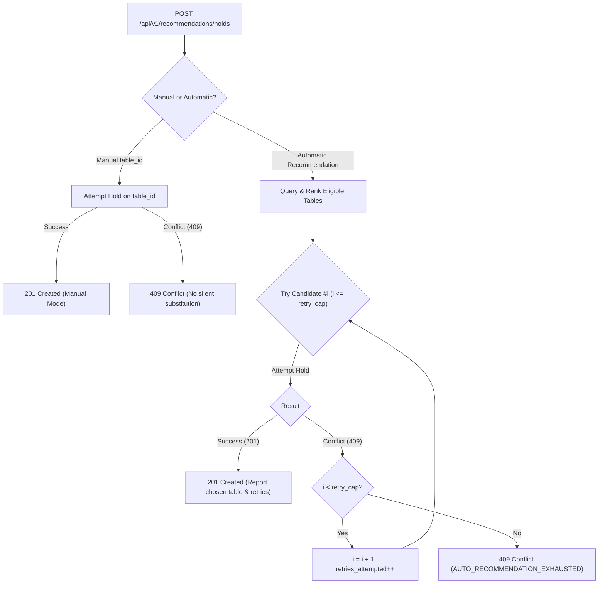

# Deterministic Table Recommendation & Bounded Fallback Engine

**Document Version:** 2.0  
**Status:** Approved & Verified Architecture Specification  
**Baseline Date:** 10 November 2026  
**Owning Epic:** [EPIC-023](../../project-delivery-kit/tasks/EPIC-023-automatic-table-recommendation-upgrade.md)  
**Dependencies:** EPIC-007, EPIC-008, EPIC-021, EPIC-022  

---

## 1. Executive Summary & Source Precedence

This specification defines the deterministic table recommendation and automatic selection engine for the Dine Hospitality Operating System under user-finalized PRD v2.0 (PRD §13, Realtime §8, and finalized technical supplements).

### 1.1 Architectural Invariants
1. **Single Atomic Inventory Authority**: Both manual floor-plan table selection and automatic table recommendation converge on the exact same PostgreSQL ACID storage tier (`inventory_claims` protected by GiST exclusion constraints). Automatic recommendations never bypass database exclusion rules.
2. **Advice Strictly Separated from Allocation**: Recommendation endpoints return ranked candidates and score explanations with `recommendation_only: true`. Generating recommendations grants NO inventory claim or hold.
3. **Manual Selection Non-Substitution Invariant**: If a customer explicitly selects a table manually (`table_id` provided, `auto_recommend: false`), the backend will **never silently switch or substitute** another table upon conflict. It returns `409 Conflict`.
4. **Bounded Automatic Retry**: In automatic recommendation mode, if candidate #1 experiences concurrent race contention, the engine deterministically falls back to candidate #2 up to a configured retry budget (`retry_cap`, default 3). It reports the actual chosen table, rank, and retry count. It never leaves orphaned or leaked claims.

---

## 2. Deterministic Scoring Model & Component Formulas

Automatic selection utilizes an authoritative, explainable mathematical scoring formula:

$$S = 0.40 \cdot C + 0.25 \cdot P + 0.20 \cdot L + 0.15 \cdot O$$

Every component is normalized to the $[0, 100]$ range.

| Component | Weight | Metric | Normalized Scoring Range |
| :--- | :---: | :--- | :--- |
| **Capacity Fit ($C$)** | `0.40` | Tightness of party fit & waste minimization | $0$ (ineligible) to $100$ (exact fit) |
| **Preference Match ($P$)** | `0.25` | Diner seating preference match with zone | $30$ (mismatch) to $100$ (exact match); default $70$ |
| **Location Suitability ($L$)** | `0.20` | Spatial floor topology & ambiance | $55$ (transit/bar) to $90$ (prime view); default $75$ |
| **Operational Efficiency ($O$)** | `0.15` | Active turns load balancing & section pacing | $50$ (high turns) to $95$ (rested table); default $70$ |

### 2.1 Capacity Fit ($C$)
Measures the capacity waste:

$$\text{waste} = \text{table.capacity} - \text{party\_size}$$

$$C = \max(0, 100 - \text{waste} \cdot 20)$$

- Exact match ($\text{waste} = 0$, e.g. 2 guests on 2-top): $C = 100$.
- Minor excess ($\text{waste} = 2$, e.g. 2 guests on 4-top): $C = 60$.
- Moderate excess ($\text{waste} = 4$, e.g. 2 guests on 6-top): $C = 20$.
- Major excess ($\text{waste} \ge 5$, e.g. 2 guests on 8-top): $C = 0$.
- Ineligible capacity ($\text{party\_size} > \text{capacity}$ or $\text{party\_size} < \text{min\_capacity}$): $C = 0$ (filtered before ranking).

### 2.2 Preference Match ($P$)
- **Missing Input Default**: If customer specifies no preference, $P = 70$ (neutral baseline).
- **Wildcard Preference (`ANY` / `NO_PREFERENCE`)**: $P = 85$.
- **Matching Zone / Keyword**: $P = 100$ (e.g. `OUTDOOR` matching Patio/Terrace/Garden; `WINDOW` matching Window/View; `INDOOR` matching Main Dining; `BOOTH` matching Booth).
- **Non-Matching Zone**: $P = 30$.

### 2.3 Location Suitability ($L$)
- **Prime View / Terrace / Window**: $L = 90$.
- **Main Dining Room / Standard**: $L = 80$.
- **High Traffic / Bar / Entrance / Restroom**: $L = 55$.
- **Missing Metadata Default**: $L = 75$.

### 2.4 Operational Efficiency ($O$)
- **0 Active Service Turns**: $O = 95$ (fresh, rested table).
- **1 Active Service Turn**: $O = 85$ (steady rotation).
- **2 Active Service Turns**: $O = 70$ (moderate load).
- **$\ge 3$ Active Service Turns**: $O = 50$ (heavy rotation).
- **Missing Operational Input Default**: $O = 70$.

---

## 3. Mandatory Eligibility-First Filter & Stable Tie-Breaking

### 3.1 Eligibility-First Filter
Before applying the scoring model, candidate tables are strictly validated against:
1. `is_active === true`
2. `table.min_capacity <= party_size <= table.capacity`
3. Zero overlapping active `table_blocks`
4. Zero overlapping active claims (`HELD`, `OFFER_HELD`, `PAYMENT_PENDING`, `PAYMENT_REVIEW`, `CONFIRMED`, `READY`, `SEATED`, `COMPLETED`)

Ineligible tables are excluded entirely from recommendation rankings.

### 3.2 Deterministic Stable Tie-Breaking
When two tables yield identical composite scores $S$, ties are deterministically resolved in the following priority order:
1. Lower capacity waste ($\text{table.capacity} - \text{party\_size}$) ASC
2. Smaller total capacity ($\text{table.capacity}$) ASC
3. Smaller min capacity ($\text{table.min\_capacity}$) ASC
4. Table label / number alphanumeric ASC
5. Table UUID lexicographical ASC

This guarantees that identical snapshots and inputs produce 100% deterministic ordered candidates.

---

## 4. Bounded Fallback Orchestration Protocol

---

## 5. API Catalog & Contracts

| Endpoint | Method | Responsibility | Auth Required |
| :--- | :---: | :--- | :---: |
| `/api/v1/recommendations/tables` | `POST` | Ranked table recommendations with score explanations | No |
| `/v1/recommendations` | `POST` | Backward-compatible legacy alias for table ranking | No |
| `/api/v1/recommendations/holds` | `POST` | Acquire atomic hold with bounded automatic fallback | Bearer JWT |
| `/api/v1/holds/auto` | `POST` | Alias for automatic hold acquisition | Bearer JWT |
